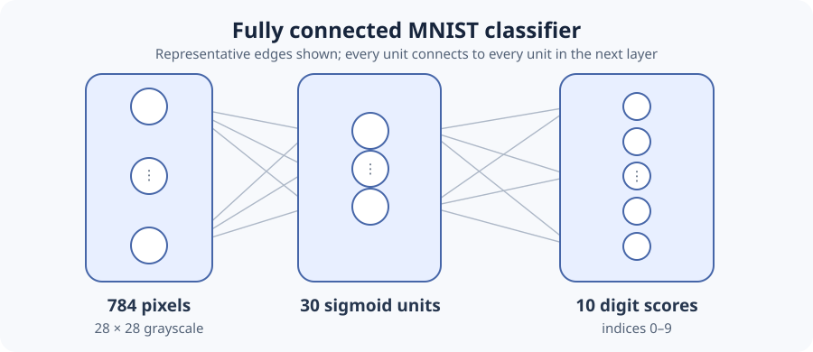
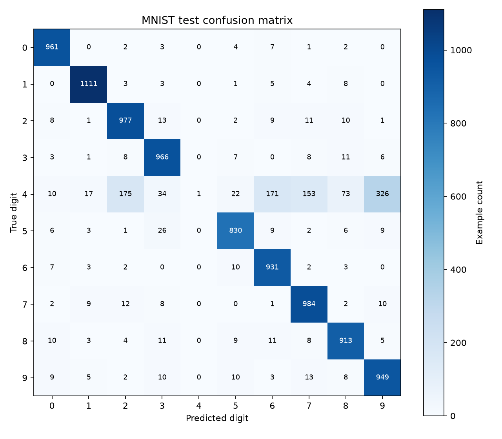
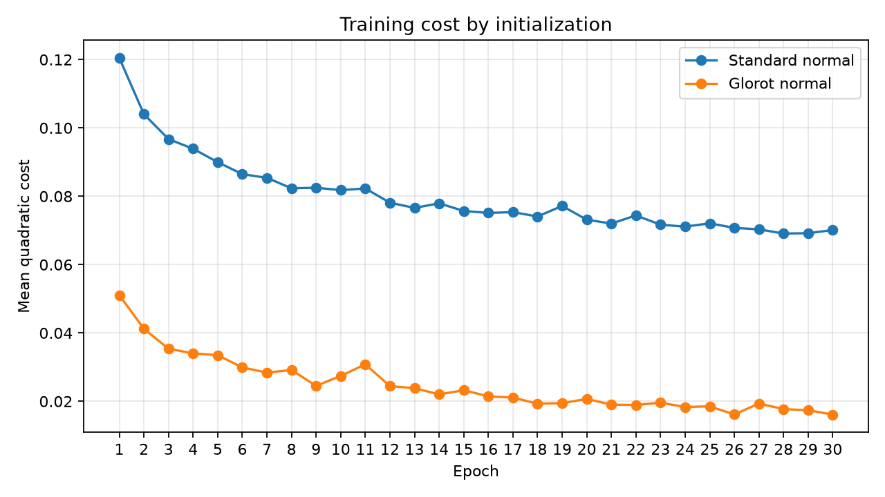
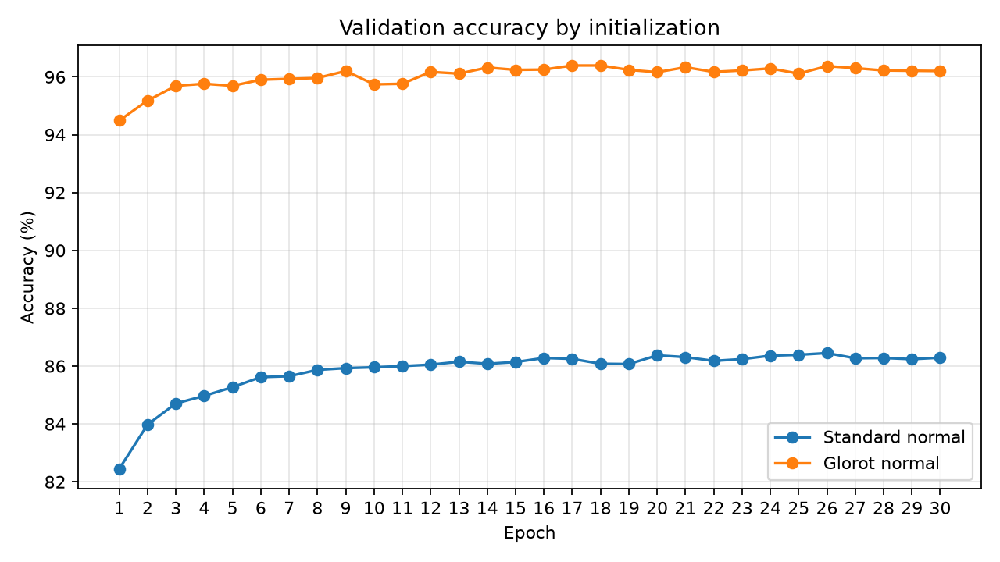
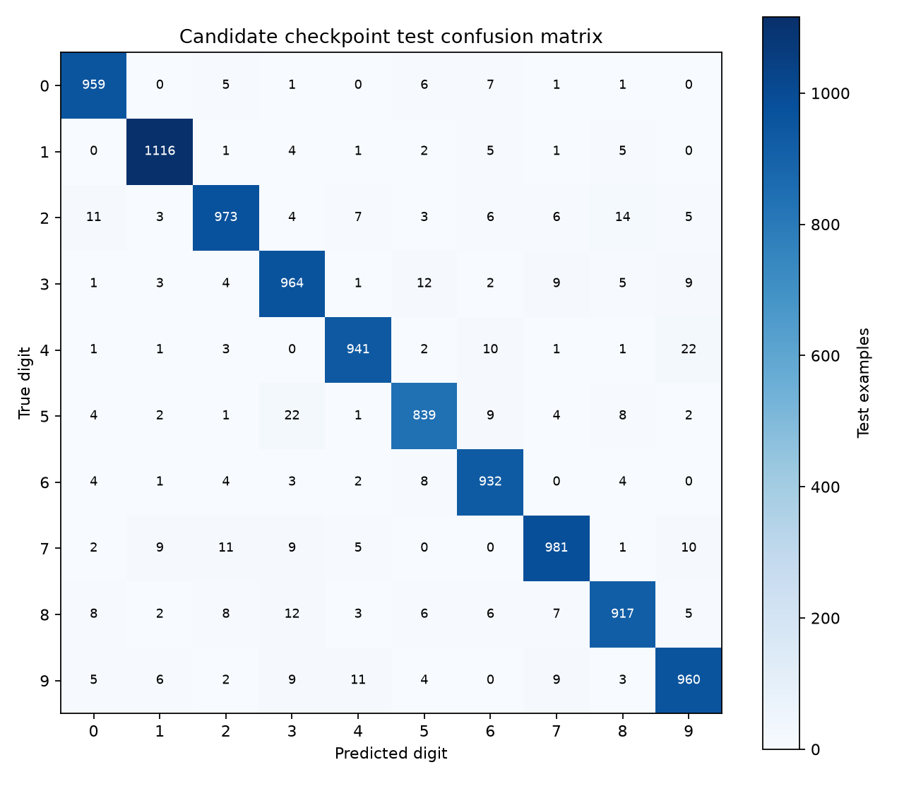
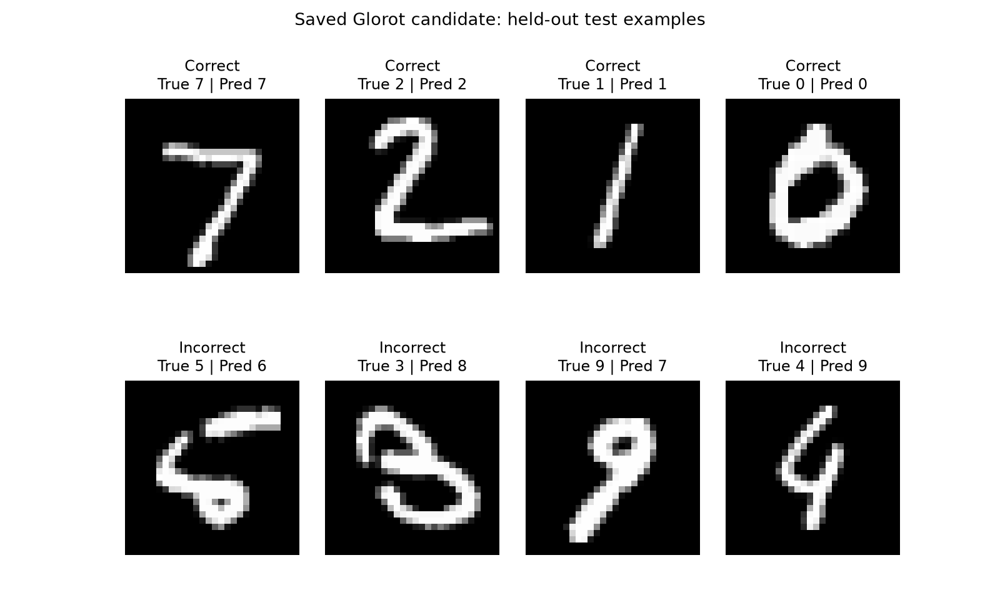

# MNIST Neural Network from Scratch

A small, inspectable handwritten-digit classifier built with Python and NumPy. The project implements the classic 784–30–10 multilayer perceptron itself: parameter initialization, sigmoid forward propagation, quadratic cost, backpropagation, and mini-batch stochastic gradient descent. Michael Nielsen's *Neural Networks and Deep Learning* is the learning reference for this educational implementation; the project is not a framework wrapper.

## Problem and architecture

MNIST contains 28 × 28 grayscale images of handwritten digits. The network flattens each image to 784 normalized inputs, computes through 30 hidden sigmoid units, and returns 10 output activations, one for each digit label 0–9. The highest output index is the predicted label. These sigmoid scores are not calibrated probabilities.



The diagram is schematic; each layer is fully connected to the next. For a layer with `fan_in` inputs and `fan_out` units, its weight matrix is shaped `(fan_out, fan_in)` and its bias column is shaped `(fan_out, 1)`.

## Technical foundations

- **Forward propagation:** `zᶫ = Wᶫ aᶫ⁻¹ + bᶫ`, then `aᶫ = σ(zᶫ)`. The sigmoid is evaluated with a numerically stable NumPy expression.
- **Sigmoid:** `σ(z) = 1 / (1 + exp(-z))`, applied elementwise.
- **Quadratic cost:** `C = ½ ||a - y||²`, where `y` is a one-hot target column.
- **Backpropagation:** uses the chain rule. At the output, `δᴸ = (aᴸ - y) ⊙ σ′(zᴸ)`; for preceding layers, `δˡ = ((Wˡ⁺¹)ᵀ δˡ⁺¹) ⊙ σ′(zˡ)`. Then `∂C/∂bˡ = δˡ` and `∂C/∂Wˡ = δˡ (aˡ⁻¹)ᵀ`. Unit tests compare these gradients with finite differences.
- **Mini-batch SGD:** updates each parameter by subtracting the learning rate times the mean gradient across the batch: `θ ← θ - η (1 / |B|) Σ ∇Cᵢ`.
- **Glorot-normal initialization:** each weight is sampled from a normal distribution with standard deviation `sqrt(2 / (fan_in + fan_out))`; biases start at zero. This is now the default. Pass `initialization="standard_normal"` to reproduce the original baseline, which drew both weights and biases from the standard normal distribution.

## Initialization investigation

The original standard-normal full run reached **86.29% validation accuracy** and correctly classified just **1 of 983 validation images labeled 4**. For true validation 4s, that checkpoint's output neuron for digit 4 had median pre-activation −14.62 and median sigmoid derivative `4.48 × 10⁻⁷`, consistent with a sigmoid saturated near zero and a very small gradient.

Its historical test result was 86.23% (8,623/10,000), with only 1 of 982 true 4s classified correctly. This is the original saved baseline report, not a result used to select the candidate.



The preserved baseline test summary, confusion matrix, and derived per-digit metrics are in `results/standard_normal_experiment_summary.json`, `results/standard_normal_test_confusion_matrix.csv`, and `results/standard_normal_test_per_digit_metrics.csv`.

Under the same architecture, data splits, seed (2026), 30 epochs, mini-batch size (10), learning rate (3.0), sigmoid, quadratic cost, and SGD implementation, the Glorot-normal run achieved **96.20% validation accuracy** and **95.52% digit-4 recall** (939/983). Training quadratic cost moved from 0.05106 at epoch 1 to 0.01613 at epoch 30. The comparison supports saturation as a strong explanation for the observed baseline failure and shows that this initialization change resolved it in this run. It does not prove initialization alone was the cause; this is a single seed and the resulting training trajectories differ.





## Verified metrics

The following metrics were read from the saved comparison and evaluation reports. Precision, recall, and F1 are reported per digit; rounded to four decimals.

### Validation: selected Glorot-normal checkpoint

Overall accuracy: **96.20% (9,620/10,000)**.

| Digit | Precision | Recall | F1 |
|---:|---:|---:|---:|
| 0 | 0.9682 | 0.9818 | 0.9749 |
| 1 | 0.9813 | 0.9850 | 0.9831 |
| 2 | 0.9662 | 0.9525 | 0.9593 |
| 3 | 0.9524 | 0.9524 | 0.9524 |
| 4 | 0.9700 | 0.9552 | 0.9626 |
| 5 | 0.9491 | 0.9377 | 0.9434 |
| 6 | 0.9587 | 0.9845 | 0.9714 |
| 7 | 0.9662 | 0.9716 | 0.9689 |
| 8 | 0.9637 | 0.9485 | 0.9560 |
| 9 | 0.9411 | 0.9469 | 0.9440 |

### Held-out test: selected Glorot-normal checkpoint

The test split was evaluated after selecting the candidate from validation. Overall accuracy was **95.82% (9,582/10,000)**. Test digit-4 recall was **95.82% (941/982)**.

| Digit | Precision | Recall | F1 |
|---:|---:|---:|---:|
| 0 | 0.9638 | 0.9786 | 0.9711 |
| 1 | 0.9764 | 0.9833 | 0.9798 |
| 2 | 0.9615 | 0.9428 | 0.9521 |
| 3 | 0.9377 | 0.9545 | 0.9460 |
| 4 | 0.9681 | 0.9582 | 0.9632 |
| 5 | 0.9512 | 0.9406 | 0.9459 |
| 6 | 0.9539 | 0.9729 | 0.9633 |
| 7 | 0.9627 | 0.9543 | 0.9585 |
| 8 | 0.9562 | 0.9415 | 0.9488 |
| 9 | 0.9477 | 0.9514 | 0.9496 |





The reports and integer confusion matrices are retained as CSV/JSON under `results/`. The images above are copies of the generated plots in `outputs/`; no plotted values were fabricated.

## Setup

Requires Python 3.10 or newer. Create an isolated environment and install the project and demo dependencies:

```powershell
py -m venv .venv
.\.venv\Scripts\Activate.ps1
python -m pip install --upgrade pip
python -m pip install -r requirements.txt
```

On macOS/Linux, activate with `source .venv/bin/activate`. To run the tests, install the same requirements and use:

```text
python -m unittest discover -s tests -v
```

The first data command downloads Nielsen's gzip-compressed MNIST pickle from the [book's data repository](https://github.com/mnielsen/neural-networks-and-deep-learning/tree/master/data) into `data/mnist.pkl.gz`. Images are converted to float64 and normalized to `[0, 1]`; labels remain integer digits 0–9. The data archive is excluded from Git. Python pickle can execute code when loaded, so only use the trusted dataset downloaded from the documented source; do not point the loader at an untrusted pickle.

## Run the project

From the repository root:

```text
python -m unittest discover -s tests -v
python train.py --help
python train.py
python evaluate_candidate.py
```

`train.py` trains using the command-line configuration (default: 50,000 training examples, 10,000 validation examples, 30 epochs, batch size 10, learning rate 3.0, seed 2026, Glorot-normal). Training and test evaluation happen when this command is explicitly run. New run artifacts default to `outputs/training_run/`, preserving the recorded artifacts. Use `--initialization standard_normal` to select the original initialization. `compare_initializations.py` reproduces the controlled comparison from the tracked baseline checkpoint and metrics; that command trains a new comparison model and takes several minutes.

`evaluate_candidate.py` loads the committed candidate checkpoint, verifies its SHA-256 and recorded validation accuracy, and then evaluates the held-out test set. It does not train or tune. The data loader may download the ignored MNIST archive if it is absent. Test metrics are written under ignored `outputs/candidate_test_evaluation/`; tracked copies of the reports are under `results/`.

## Interactive drawing demo

Start the local Streamlit app from the repository root:

```powershell
streamlit run app.py
```

The app loads `models/mnist_glorot_candidate.npz` once and uses the existing NumPy `Network.feedforward()` implementation. It does not load or download MNIST, train the model, or call an external AI service. Draw a digit using a mouse or touchscreen, then select **Predict**; **Clear** resets the canvas. The displayed **95.82%** is the saved candidate's evaluation on the held-out MNIST test set, not an accuracy measure for visitor drawings.

The project loader's MNIST images have dark corners/background and brighter digit pixels normalized to `[0, 1]`. The canvas therefore uses white ink on black. Preprocessing composites transparency over black, crops the non-background pixels, preserves aspect ratio while fitting the drawing inside a 20 × 20 region, places it on a 28 × 28 canvas, and shifts its intensity center toward the middle before flattening to `(784, 1)`. This approximates common MNIST centering, but it is not the original MNIST preprocessing pipeline: visitor handwriting, stroke width, drawing position, and antialiasing can differ.

## Checkpoints and artifacts

The candidate and historical baseline checkpoints are small (about 185 KB each) and are included under `models/` with SHA-256 and experiment metadata. This allows loading and evaluation without retraining. For example:

```python
from evaluate_candidate import load_checkpoint

network = load_checkpoint("models/mnist_glorot_candidate.npz")
```

The checkpoint stores architecture, initialization name, seed, and each layer's NumPy weights and biases. It is loaded with `allow_pickle=False`.

For a single validation-image inference (without running a full evaluation):

```python
import numpy as np
from src.data import load_data
from evaluate_candidate import load_checkpoint

network = load_checkpoint("models/mnist_glorot_candidate.npz")
_, (images, labels), _ = load_data()
scores = network.feedforward(images[0].reshape(784, 1))
prediction = int(np.argmax(scores))
print(f"true={labels[0]}, predicted={prediction}, output shape={scores.shape}")
```

The saved candidate produced a `(10, 1)` output for the first validation image; its label and prediction were both 3 in the recorded environment.

### Repository layout

```text
.
├── compare_initializations.py       # Reproduce standard-vs-Glorot comparison
├── data/                            # Downloaded MNIST data (ignored; .gitkeep tracked)
├── docs/images/                     # Architecture and verified experiment visuals
├── evaluate_candidate.py            # Checkpoint verification and held-out evaluation
├── main.py                          # MNIST split/sample inspection entry point
├── models/                          # Small candidate and baseline checkpoints + metadata
├── requirements.txt                 # NumPy and Matplotlib only
├── results/                         # Tracked CSV/JSON reports and epoch metrics
├── src/data.py                      # Dataset download, parsing, normalization
├── src/network.py                   # NumPy network, gradients, and SGD
├── tests/test_network.py            # Unit and finite-difference gradient tests
└── train.py                         # Reproducible configurable training experiment
```

## Limitations and next steps

- The hidden layer has only 30 units; more capacity could improve difficult examples but would need a separately designed experiment.
- Sigmoid units can saturate and produce small derivatives. The old standard-normal run is a concrete example; Glorot initialization helped in this experiment but does not eliminate saturation in general.
- The reported model metrics come from one fixed seed and one MNIST split. They are not a confidence interval or a guarantee for other seeds or data sources.
- The output activations are sigmoid scores, not calibrated class probabilities.
- The loader reads Nielsen's pickle format, which is convenient for this educational project but should not be used with untrusted files.
- Useful next learning steps would be repeated-seed evaluation, calibration analysis, and comparing against a carefully documented softmax/cross-entropy model. Those changes are outside this project's current implementation and were not evaluated here.

## License

This project is licensed under the MIT License; see [`LICENSE`](LICENSE). The license applies to this project's code and documentation. It does not relicense Michael Nielsen's book or the MNIST dataset.
